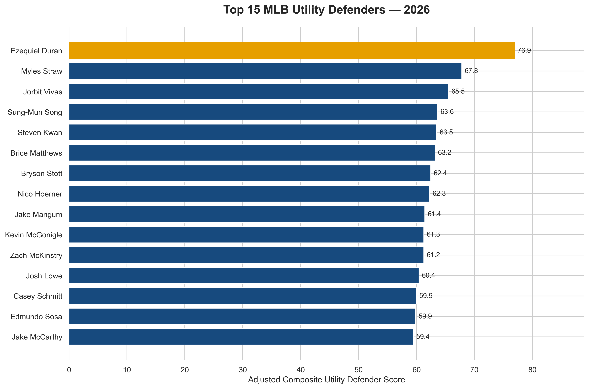
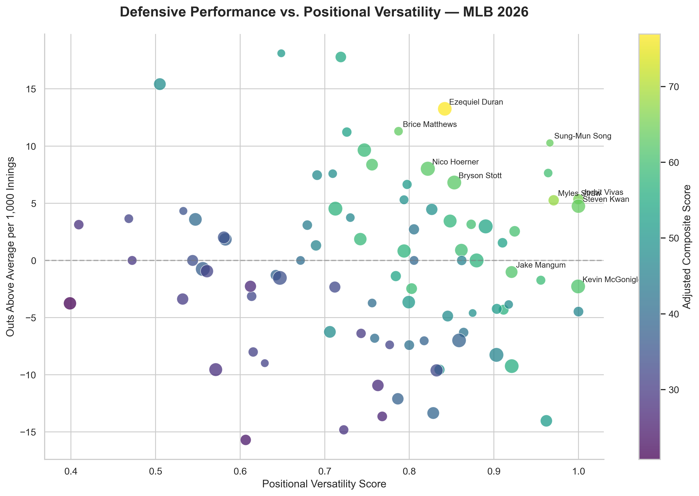
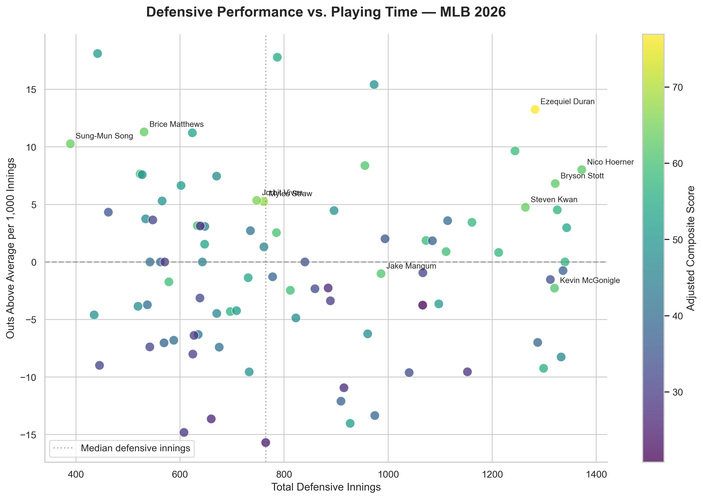
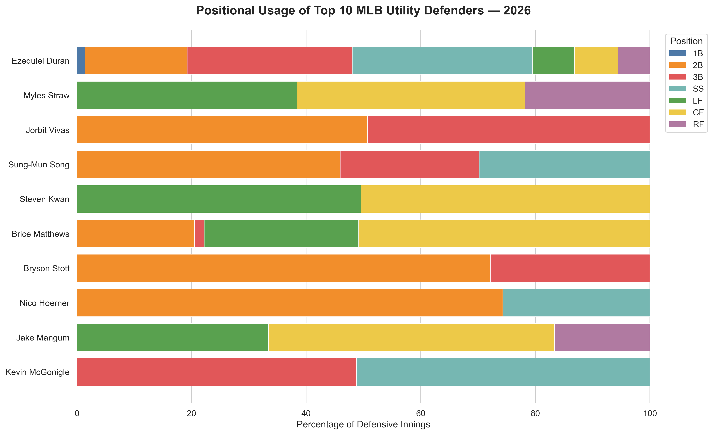
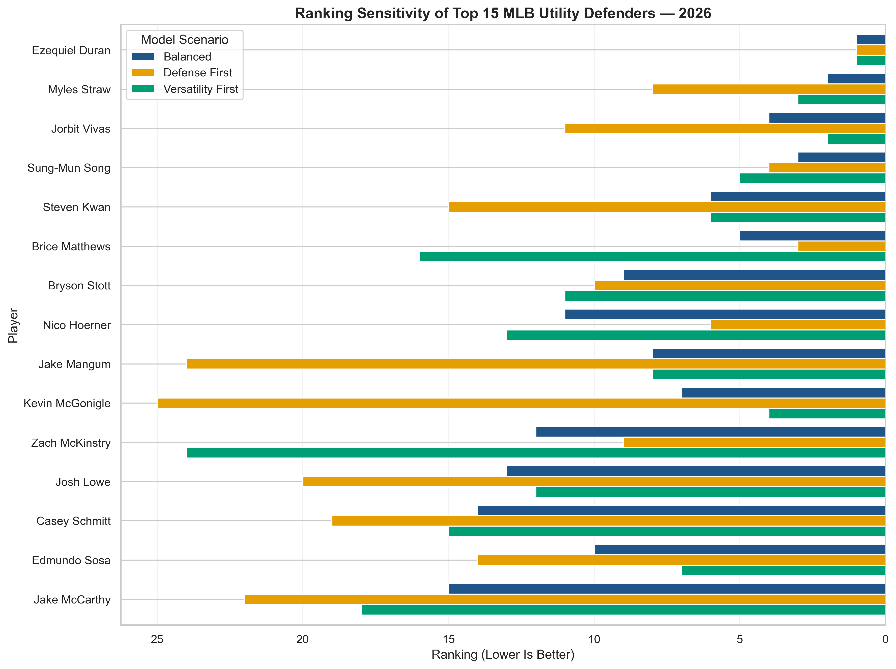

# MLB 2026 Utility Defender Value

### Evaluating Defensive Performance, Positional Versatility, and Roster Flexibility Using Python

## Project Overview

How can MLB organizations identify players who provide value through both defensive performance and the ability to cover multiple positions?

This project develops a custom defensive evaluation framework to compare 89 eligible MLB utility defenders during the 2026 season.

Rather than relying exclusively on traditional fielding statistics, the model combines Outs Above Average (OAA), positional versatility, defensive playing time, and positional responsibilities into a composite score.

The project emphasizes reproducible analysis, model sensitivity testing, and baseball operations applications.

## Research Question

**Which MLB utility defenders provide the strongest combination of defensive performance, positional flexibility, and playing-time value?**

Catchers are excluded because their defensive responsibilities require a separate evaluation framework.

## Tools and Technologies

- Python
- pandas and NumPy
- Matplotlib and Seaborn
- Jupyter Notebook
- Visual Studio Code
- Baseball defensive and Statcast-style metrics

## Methodology

Five components contribute to the balanced defensive value model:

| Component | Weight |
|---|---:|
| OAA per 1,000 defensive innings | 45% |
| Positional versatility | 25% |
| Meaningful positions played | 15% |
| Demanding-position share | 10% |
| Total defensive innings | 5% |

Each component is normalized before contributing to a weighted composite score.

The model also evaluates defense-focused and versatility-focused weighting scenarios to assess ranking stability.

For a detailed explanation, see [Methodology](docs/methodology.md).

## Top Five Utility Defenders

The balanced adjusted model produced the following top-five rankings:

| Rank | Player | Composite Score | OAA | Defensive Innings |
|---|---|---:|---:|---:|
| 1 | Ezequiel Duran | 76.93 | 17 | 1,282.3 |
| 2 | Myles Straw | 67.81 | 4 | 760.7 |
| 3 | Jorbit Vivas | 65.51 | 4 | 747.3 |
| 4 | Sung-Mun Song | 63.64 | 4 | 389.3 |
| 5 | Steven Kwan | 63.48 | 6 | 1,263.7 |

These rankings reflect the custom model rather than an official MLB defensive leaderboard. Source-data verification is required before interpreting them as confirmed 2026 results.

## Key Findings

**1. Ezequiel Duran ranked first across all three weighting scenarios.**

Duran's model results combined strong adjusted defensive performance with meaningful positional flexibility.

**2. Versatility materially influences player rankings.**

Players with balanced defensive playing time across multiple positions can rank highly even without the greatest cumulative OAA.

**3. Model assumptions affect the results.**

Changing the emphasis between defensive performance and versatility produced substantial ranking movement.

**4. Eligibility rules also influence the rankings.**

When players with nonpositive OAA rates were excluded, 16 of the original top 20 remained, while all five leading players retained their positions.

## Visualizations

### Top 15 Utility Defender Rankings



### Defensive Performance vs. Positional Versatility



### Defensive Performance vs. Playing Time



### Positional Usage of Top 10 Defenders



### Model Sensitivity Analysis



## Repository Structure

```text
MLB-2026-Utility-Defender-Value/
├── data/
├── docs/
│   └── methodology.md
├── notebooks/
│   ├── 01_data_collection.ipynb
│   ├── 02_defensive_metrics.ipynb
│   └── 03_defensive_visualizations.ipynb
├── reports/
├── visuals/
└── README.md
```
## Data Sources

This project combines two MLB defensive datasets:

**1. MLB Stats API — 2026 Fielding Statistics**

- Source: https://statsapi.mlb.com/api/v1/stats
- Season: 2026
- Statistical group: Fielding
- Data includes player identifiers, defensive positions, and fielding statistics.

**2. Baseball Savant — Statcast Outs Above Average**

- Source: https://baseballsavant.mlb.com/leaderboard/outs_above_average
- Season: 2026
- Data obtained through a CSV export of the Statcast Outs Above Average leaderboard.
- The imported dataset contains 273 player records.

The datasets are combined using MLB player identifiers to connect positional playing time with defensive performance.

The resulting analysis evaluates 89 eligible utility defenders.

**Data validation:** Internal checks found no duplicate player IDs, missing required values, invalid defensive innings, OAA rate inconsistencies, or out-of-range composite scores.

The source files' extraction dates and agreement with the original published records should be independently confirmed before treating the rankings as verified 2026 results.
## How to Run This Project

### 1. Clone the Repository

```bash
git clone https://github.com/cameronboardman2022/MLB-2026-Utility-Defender-Value.git
cd MLB-2026-Utility-Defender-Value
```

The clone command will work once the repository has been published at this URL.

### 2. Install Dependencies

```bash
python -m pip install -r requirements.txt
```

### 3. Run the Notebooks

Open the project in Visual Studio Code or Jupyter Notebook.

Run the notebooks in the following order:

1. `notebooks/01_data_collection.ipynb` — Collect and prepare MLB positional fielding data.
2. `notebooks/02_defensive_metrics.ipynb` — Integrate Statcast OAA and calculate defensive value scores.
3. `notebooks/03_defensive_visualizations.ipynb` — Generate visualizations and evaluate ranking sensitivity.

### 4. Review the Results

The project outputs include:

- Ranked utility defender datasets in `data/`
- Defensive performance and versatility visualizations in `visuals/`
- Model sensitivity comparisons
- Player evaluations and methodology documentation

**Note:** Reproducing the analysis requires the 2026 Baseball Savant OAA CSV (`data/outs_above_average.csv`) and any other source data referenced by the notebooks. Results also depend on the source data version and extraction date.
## Limitations

- OAA rates can be unstable over smaller defensive samples.
- Composite rankings depend on the selected model weights.
- Positional versatility does not guarantee above-average defense at every position.
- The composite score is not directly equivalent to runs saved or WAR.
- The underlying data source, season filters, and extraction date must be independently verified before publication.

## Baseball Operations Applications

This framework could support:

- Identifying versatile defensive roster candidates
- Comparing players with different positional usage patterns
- Evaluating roster flexibility alongside defensive performance
- Developing preliminary player acquisition and scouting shortlists
- Communicating analytical findings to player development and baseball operations personnel

The model is intended as a decision-support tool rather than a replacement for traditional scouting or video evaluation.

## Author

**Cameron Boardman**

NCAA Division I Baseball Player | MBA, Business Analytics | NJIT Graduate Certificate in Business Analytics

[GitHub](https://github.com/cameronboardman2022) | [Analytics Portfolio](https://sites.google.com/view/cameronboardman/home)
